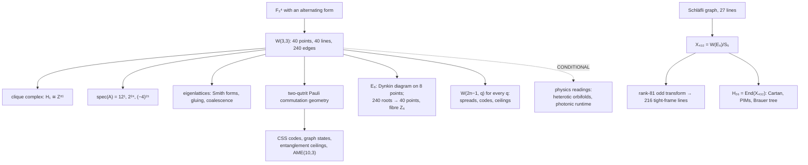

<div align="center">

# W(3,3)

### One finite geometry, pushed as far as exact computation goes

[](https://wilcompute.github.io/W33-Theory/)
[](https://github.com/wilcompute/W33-Theory/actions/workflows/pytest.yml)
[](https://github.com/wilcompute/W33-Theory/actions/workflows/compile_sweep.yml)


[](LICENSE)

**40 points · 40 lines · `SRG(40,12,2,4)` · `Aut ≅ W(E₆)`, order 51,840**

*Thousands of exact artifacts. Named maps, not matching integers. Reproducible certificates. Public corrections.*

[Read the atlas](https://wilcompute.github.io/W33-Theory/) · [Master paper](docs/pdf/w33_paper.pdf) · [W33 for Everyone](W33_FOR_EVERYONE.pdf) · [Find a result](#find-a-result-before-you-derive-it) · [What we got wrong](#what-we-got-wrong-in-public)

</div>

---

Start with the symplectic space `F₃⁴`. Its totally isotropic points and lines form the generalized quadrangle
**`W(3,3)`**: 40 points, 40 lines, each point on 4 lines, and a collinearity graph `SRG(40,12,2,4)` whose
automorphism group is `PGSp(4,3) ≅ W(E₆)`. It is also the **commutation geometry of two qutrits**: the 40
points are the two-qutrit Pauli operators up to phase and powers, two points are collinear when the operators
commute, and the 40 lines are the maximal commuting sets.

This repository is everything that has been computed *exactly* from that one object: homology and integral
lattices, modular representations and Hecke algebras, quantum codes and graph states, exceptional-group
carriers (`E₆`, `E₇`, `E₈`), finite-field generalisations `W(2n−1, q)`, and a long, honest attempt to read
physics out of it. Every promoted claim names its witness. Every retraction keeps its failure certificate.

> **The boundary, stated up front.** The finite mathematics is exact. The *physical* readings (which object is
> a generation, a coupling or an optical mode) are `CONDITIONAL`, because identifying a combinatorial object
> with a physical one is a map that must be built, not inferred from a matching integer. Of fourteen published
> constant formulas, two survive σ-testing, and the table showing the other twelve fail is
> [below](#physics-constants-checked-in-experimental-σ), not in a drawer.

## At a glance

| | |
|---|---|
| **Passes** | ~12,470 numbered research passes, by two AI research tracks working in parallel ([how](#how-two-research-tracks-share-one-corpus)) |
| **Executable witnesses** | 7,344 Python and 280 GAP programs in `analysis/`, plus 56 Lean 4 modules in `formal/` |
| **Certificates** | 7,495 deterministic JSON certificates in `data/` |
| **Tests** | 57,062 pytest cases collected |
| **Manuscripts** | 24 LaTeX documents, all building in CI with 0 errors and 0 undefined references |
| **History** | 23,600+ commits since 2026-01-16 |

---

## Contents

- [What is established](#what-is-established)
- [The certified backbone](#the-certified-backbone)
- [Current frontiers (October 2026)](#current-frontiers-october-2026)
- [Choose your route](#choose-your-route)
- [Evidence tiers](#evidence-tiers) · [Canonical names](#canonical-names-that-must-not-be-conflated)
- [Physics constants, checked in experimental σ](#physics-constants-checked-in-experimental-σ)
- [What we got wrong, in public](#what-we-got-wrong-in-public)
- [Find a result before you derive it](#find-a-result-before-you-derive-it)
- [How the repository checks itself](#how-the-repository-checks-itself)
- [How it grew](#how-it-grew)
- [Reproduce](#reproduce) · [Repository map](#repository-map) · [Cite](#citation-provenance-license)

---

## What is established

| Result family | Best current result | Tier | Owner |
|---|---|---|---|
| **Geometry and homology** | Canonical `W(3,3)`; clique-complex `H₁ ≅ Z⁸¹`; qutrit CSS sector `[[240,81,3]]₃` | `PROVED` / `CERTIFIED` | [master paper](docs/pdf/w33_paper.pdf) · [Passes 373–374](PASS373_374_W33_BOUNDARY_MLUT_PHASE_SHEET_SYNTHESIS.md) |
| **Integral spectral arithmetic** | Exact Smith forms of every eigenlattice; prime-by-prime gluing; the two-branch, k-branch and **coalescence** theorems | `PROVED` / `CERTIFIED` | [Pass 828](analysis/w33_pass828_coalescence_theorem.py) · [Pass 1002](analysis/BT999_1003_five_frontier_release.md) |
| **Exceptional carrier bridge** | Three 432-state carriers → explicit odd transform into `81₋` → 216 tight-frame lines; Smith profile `1¹⁵,2⁶,4⁸,8²⁹,40²³` | `CERTIFIED` | [Pass 1147](PASS1147_SCHLAEFLI_STEINBERG_FOURIER_BRIDGE.md) |
| **Modular representation theory** | Literal 26-dim Hecke algebra `H₂₆`: Cartan matrices and PIMs at `p = 2,3,5`, idempotents lifted through `p⁶`; cyclic-defect Brauer tree `1−24−81−64−6` | `CERTIFIED` | [Pass 1335](PASS1335_BRAUER_TREE_HECKE_CORNER.md) · [Passes 1340–1344](PASS1340_1344_CARTAN_ATLAS_SELECTOR_PADIC_RELEASE.md) |
| **Selector algebra** | 120-selector action with 83 orbitals and Wedderburn algebra `Q⁷ ⊕ M₂(Q)² ⊕ M₃(Q)³ ⊕ M₄(Q) ⊕ M₅(Q)`, realised by 83 exact matrix units | `CERTIFIED` | [Passes 1355–1384](analysis/BT1355_BT1359_selector_matching_scheme.md) |
| **All odd q** | Regular symplectic spreads form an explicit SRG for every odd prime power; complete `q = 27` spectra and a 9-divisible `[730,5]₂₇` code | `PROVED` / `CERTIFIED` | [Passes 2200–2206](PASS2200_2206_ALL_Q_SPREADS_NONREGULAR_CONTROLLER_RTL_RELEASE.md) · [Pass 2304](analysis/w33_pass2304_known_q27_spread_spectra.py) |
| **E₈ in the geometry** | Eight points induce the `E₈` Dynkin diagram (`det = 1`); a 6:1 `Sp(4,3)`-equivariant fibration **240 E₈ roots → 40 points**, fibre `Z₆`; the naive edge↔root bijection is provably obstructed | `CERTIFIED` | [Pass 1012](analysis/w33_pass1012_edge_root_equivariance_obstruction.py) · [archived edition](docs/README_2026-08_EDITION.md#a-verified-structural-result-e₈-inside-w33) |
| **Quantum codes from `W(3,q)`** | Line-graph binary kernel: distance `q+1` for every odd q ([Pass 4754](analysis/PASS4754_oddq_kernel_distance_theorem.md)). Point-graph CSS family `[[q³+q²+q+1, q²−1, d]]`: `d = 2q` exact at `q = 3, 5`; `d ≥ q+3` for every odd q; every sum of `≤ q+1` lines has weight `≥ 2q` | `PROVED` / `CERTIFIED` | [Passes 12450–12465](analysis/PASS12458_12465_VACUUM_THRESHOLDS_KLINES_MBQC.md) |
| **Graph states and entanglement** | Entanglement ceiling `rank_p(A+I) = 1 + C(2n+p−2, 2n−1)` for `W(2n−1,q)` graph states (point–hyperplane incidence, Smith 1969); every graph is an induced subgraph of some `W(2N−1,q)` | `CERTIFIED` | [Passes 12418–12425](analysis/PASS12418_12425_ONE_IDENTITY_TWO_CODES.md) · [Pass 12462](analysis/PASS12458_12465_VACUUM_THRESHOLDS_KLINES_MBQC.md) |
| **Absolutely maximally entangled states** | The sign structure of `AME(10,3)` is the Steiner system `S(3,4,10)` under `PGL(2,9)`; the five-qutrit conjecture is proved | `PROVED` / `CERTIFIED` | Pass 11190 |
| **Executable runtime** | HoloBox: a recursive addressed network that runs as one VM, with independent Python and GAP certificates | `CERTIFIED` (model) | [runtime guide](docs/W33_FRACTAL_MICROVM_RUNTIME.md) |

The August-2026 edition of this README holds the long form of this table, with about thirty rows, exact statements and owning
artifacts for every row: [docs/README_2026-08_EDITION.md](docs/README_2026-08_EDITION.md).

---

## The certified backbone



---

## Current frontiers (October 2026)

**Codes and quantum information** [`CERTIFIED`]
- The `W(3,q)` adjacency CSS family, with `d = 2q` reduced to one remaining case: words whose every
  representation needs at least `q + 2` lines. The minimal *even* line sets are 6, 10 and 20 lines at `q = 2, 3, 5`.
  For odd q that exceeds the `2(q+1)` a grid would give.
- Fault tolerance for `[[40,8,6]]`: an exact one-flag extraction certificate (2,460 fault insertions, 0 dangerous
  unflagged cases), and an exhaustive bound on two-fault failure.
- `W(2n−1, p)` graph states reach every graph state by Pauli measurements, but at fixed qudit dimension they are
  classically simulable in polynomial (qubits) or quasi-polynomial (qutrits) time.

**Photonic witnesses** [`CERTIFIED` finite model · `CONDITIONAL` hardware]
- Exact three-photon optical discrimination between `W(3,3)` and its dual, with calibrated shot budgets and
  arbitrary-Gram robustness checks. The finite statistics are certified; the device is not built.

**Heterotic string search** [the route below is `CLOSED`]
- `W(3,3)` hosts Standard-Model-like spectra in `Z₆` orbifolds of `E₈ × E₈` and `SO(16) × SO(16)`.
- The best non-supersymmetric lineage (SM_2541) passes three generations, an anomaly-free hypercharge, large-radius
  stability, freedom from exotics, liftable fractional charges and a D-flat vacuum. It then **fails gauge-coupling
  unification**: the hypercharge level `k_Y ≥ 11/3` against the `≈ 1.3` that is required
  ([Passes 12450–12473](analysis/PASS12466_12473_DUAL_LINES_EVEN_SETS_KY_FLOOR.md)).
- What a viable model would need: `1 ≤ k_Y < 5/3`, and therefore string states with fractional charge that are
  liftable.

**Finite kinematics** [`CERTIFIED` · `CONDITIONAL` reading]
- `E₈` real forms as two-qutrit structures.
- A finite `AdS₄` with `SL(2,9)` Lorentz symmetry, built from two qutrits.
- `W(3,3)` as the level-3 structure of a genus-2 Siegel modulus.

These are kinematics; no dynamics is claimed.

---

## Choose your route

| You are… | Start here | Then |
|---|---|---|
| **Curious** | [Live atlas](https://wilcompute.github.io/W33-Theory/) · [W33 for Everyone](W33_FOR_EVERYONE.pdf) | [Practical implications](docs/pdf/holonet_practical_implications.pdf) |
| **A mathematician** | [Master paper](docs/pdf/w33_paper.pdf) ([source](w33_paper.tex)) | [Forty points](papers/forty_points/main.pdf), the paper with one ledger row per pass block · [`RESULTS_INDEX.md`](RESULTS_INDEX.md) |
| **A reviewer** | [Reproduce](#reproduce) | [certificates](data/) · [tests](tests/) · [what we got wrong](#what-we-got-wrong-in-public) |
| **Into lattices and deformations** | [Determinant-law paper](docs/pdf/heisenberg_weyl_determinant_law.pdf) | [archived eigenlattice tables](docs/README_2026-08_EDITION.md#eigenlattices-gluing-and-the-e₈-boundary--the-2026-07-arc) |
| **Into photonics and systems** | [Photonic Holonet](docs/pdf/photonic_holonet.pdf) ([source](photonic_holonet.tex)) | [`HOLONET.md`](HOLONET.md); treat implementation claims as `CONDITIONAL` |
| **Building runtimes** | [HoloBox evidence card](docs/holobox-fractal-microvm.html) | [runtime guide](docs/W33_FRACTAL_MICROVM_RUNTIME.md) |
| **Deciding whether to fund this** | [Machine blueprint](holonet_machine_blueprint.pdf), Part I | its **What is not built** section and **errata index** |

**The three flagship manuscripts** share one reader convention: **cream** boxes are plain language, **blue**
boxes carry exact statements with their scope, and **rose** boxes keep claims we published and then withdrew,
with the measurement that overturned them.

| Document | What it is |
|---|---|
| [`w33_paper.tex`](w33_paper.tex) | The research atlas: everything established about `W(3,3)`, evidence-tiered |
| [`holonet_machine_blueprint.tex`](holonet_machine_blueprint.tex) | A computer specified by the geometry: instruction set, gate counts, thermodynamics |
| [`photonic_holonet.tex`](photonic_holonet.tex) | One self-entangled photon as computer, network and clock |

---

## Evidence tiers

| Tier | Meaning |
|---|---|
| `PROVED` | A mathematical proof or a named formal theorem. For Lean, build the named module; a file's existence proves nothing. |
| `CERTIFIED` | Exact computation with a deterministic witness, a certificate, and a focused test. |
| `CONDITIONAL` | The finite mathematics is sound; an interpretation or implementation map is still missing. |
| `OPEN` | A precise question with no completed witness. |
| `RETRACTED` | Promoted, then refuted; kept together with the certificate that refutes it. |

A certificate is idempotent: rerun its producer and it must reproduce. `CERTIFIED` covers the named finite
computation only; it never upgrades an attached physical interpretation.

## Canonical names that must not be conflated

| Name | Meaning |
|---|---|
| `Γ = W33` | The graph from symplectic orthogonality on `PG(3,3)`, not an arbitrary `SRG(40,12,2,4)`. **28** graphs share those parameters. |
| `G₀` | `PSp(4,3)`, order 25,920 |
| `G = Aut(Γ)` | `PGSp(4,3) ≅ W(E₆)`, order 51,840. `Sp(4,3)`, of the same order, is a central double cover, not this action. |
| `H₁(Γ)` | `Z⁸¹`, the first homology of the clique complex |
| `X₄₃₂` | `W(E₆)/S₅`, the directed edges of the Schläfli graph |
| `81₋` | The Pass 1147 constituent; it is **not** silently identified with `H₁(Γ)` |
| `H₂₆` | `End_G(X₄₃₂)`, the literal 26-dimensional coset Hecke algebra |
| Selector orbital algebra | `End_H(Q¹²⁰)`, dimension 83; its matrix units do **not** belong to `H₂₆` |

Aliases, superseded names and pass ownership are recorded in [`RESULTS_VOCABULARY.md`](RESULTS_VOCABULARY.md) and
[`data/ALIAS_REGISTRY.json`](data/ALIAS_REGISTRY.json).

---

## Physics constants, checked in experimental σ

We evaluated every closed form in the most-cited constants ledger and compared it with PDG-2025 in standard deviations,
not percent. **Only 5 of 14 formulas even evaluate to their own stated value**, and only two rows survive both tests.

| Observable | Closed form | Evaluates to | PDG-2025 | Verdict |
|---|---|---:|---|---|
| `N_ν` | `q` | 3 | 3 | ✅ exact |
| `sin²θ₂₃` (PMNS) | `7/13` | 0.53846 | 0.546 ± 0.021 | ✅ agrees (0.4σ) |
| `m_t` (pole) | `v_EW/√2` | 173.948 GeV | 172.57 ± 0.29 | ⚠️ formula OK, value excluded (4.8σ) |
| `sin²θ_W` | `q/(q²+q+1) = 3/13` | 0.230769 | 0.23122 ± 0.00003 | ⚠️ formula OK, value excluded (15σ) |
| `α⁻¹` | `k² − 7 = 137` | 137 | 137.035999… | ✅ the integer only; the `.036` is **not** derived |
| `m_H`, `Ω_Λ`, `sin²θ₁₃`, `m_W/v_EW` | (as published) | — | — | ❌ reachable by **no** expression among 7,128 searched; **withdrawn** |
| `|V_us|`, `H₀`, `n_s`, `sin²θ₁₂`, ledger `α⁻¹` | (as published) | — | — | ❌ the formula as written does not evaluate to the claim |

The gap is between *counting the geometry*, which works exactly, and *predicting a dimensionful constant*, which so far
does not. ([Pass 1010](analysis/w33_pass1010_constant_rederivation_and_rank_bound.py); full table in the
[archived edition](docs/README_2026-08_EDITION.md#physics-constants--every-derivation-verified-or-flagged).)

---

## What we got wrong, in public

This is the section that makes the rest trustworthy. Each entry kept its failure certificate.

| Claim | What killed it | Pass |
|---|---|---|
| Flat-block gluing `= (Z/q)^((q²−1)/2)` | It glued unsaturated images, using a buggy hand-written Smith routine. The truth is `(Z/2)^((q−1)²/2)`. | 808 |
| CKM angles from Ihara phases ("11% agreement") | In σ: `θ₁₂` 28.8σ, `θ₁₃` 62.9σ off. The source file had kept the closest of four formulas. | 981 |
| `[W(E₈) : Sp(4,3)] = 480` | It is 13,440. | 981 |
| A 240 edge ↔ 240 root bijection | The edges form one orbit and the roots four (`72+6+81+81`), so no equivariant bijection exists. | 1012 |
| "78 = dim E₆ identifies W(3,3)" | All 28 graphs with these parameters give 78. | 4281 |
| "The instruction layer can be Ramanujan" | The graph measured was the torus `C₃⁴`; its Clifford generator drew no edges. | 4201 → 4204 |
| "Hodge-star closure for every odd q" | It holds for `q ≡ 3 mod 4`; for `q ≡ 1 mod 4` a trace condition is needed (and only for `p ≠ 3`). | 12402 → 12410 |
| "SM_2541 keeps an unliftable fractional pair" | The lifting test paired only distinct fields. The leftovers take **Majorana** masses. | 12437 → 12451 |
| "Qutrit Pauli-geometry graph states may be universal resources" | At fixed qudit dimension they are quasi-polynomially simulable. | 12445 → 12462 |

**The five failure modes this corpus has actually produced**, from easiest to hardest to catch:

1. **Coordinate artefacts**
2. **Over-reads**
3. **Unbuilt objects**
4. **Unbuilt halves**
5. **Rediscovery**

The last cannot be self-checked, because novelty is a property of the corpus, not of the claim. It can only be
searched for. The 2026-08 correction tables are in the [archived edition](docs/README_2026-08_EDITION.md#things-we-got-wrong-on-purpose-and-in-public).

---

## Find a result before you derive it

The corpus is indexed by *when* someone worked (`PASS12458_…`, `2026-07-10_…`), not by *what* they found. So
search for the **result itself**: the formula, the integer, the code parameter.

```bash
py -3 scripts/find.py "k(q+2-k)"            # live tree + commit subjects, hits dated oldest-first (the owner)
py -3 scripts/find.py -E "\[\[40, ?8, ?6\]\]" --certs --repos   # also certificates and the other repositories
```

| Question | Tool |
|---|---|
| Has this result, formula, integer or code parameter appeared anywhere? | [`scripts/find.py`](scripts/find.py) |
| Result → file inverted index | [`RESULTS_INDEX.md`](RESULTS_INDEX.md) |
| Which certificate asserts a value, and under which key? | [`scripts/cert_query.py`](scripts/cert_query.py) · [`KEY_VOCABULARY.md`](KEY_VOCABULARY.md) |
| `[[n,k,d]]` codes in every repository | [`CODE_PARAMETER_INDEX_ALL_REPOS.md`](CODE_PARAMETER_INDEX_ALL_REPOS.md) |
| Where does everything live, and where does new work go? | [`REPO_MAP.md`](REPO_MAP.md) |

### How two research tracks share one corpus

Two AI research tracks (Claude and Codex) work this repository in parallel, and neither reads the other's filenames.
That is a *structural* cause of rediscovery, so the defences are structural too:

- **Reserve before you compute:** claim a pass number with an empty commit first.
- **Search by result before you claim:** the pre-commit hook [`check_rediscovery.py`](scripts/check_rediscovery.py)
  warns on collisions; it never blocks.
- **The earlier commit owns a result; the later one cites it.**

The full protocol is in [`CLAUDE.md`](CLAUDE.md).

---

## How the repository checks itself

Every checker has been verified against a *planted fault*. A checker that has only ever reported clean has unknown recall.

| Check | Catches |
|---|---|
| [`pytest`](.github/workflows/pytest.yml) | Changed tests on every push; the full suite (57k cases) weekly and on demand |
| [`compile_sweep.py`](scripts/compile_sweep.py) | Every manuscript building with 0 errors; undefined or duplicate labels gate CI |
| [`check_rediscovery.py`](scripts/check_rediscovery.py) | A staged result already present elsewhere, uncited |
| [`first_appearance.py`](scripts/first_appearance.py) | Who owns a result: the first commit that added it |
| [`check_bootstrap_payloads.py`](scripts/check_bootstrap_payloads.py) | Chunk-encoded payloads that no longer match their manifest hashes |
| [`find_orphaned_inserts.py`](scripts/find_orphaned_inserts.py) | Finished write-ups that no manuscript includes |
| [`check_certificates.py`](scripts/check_certificates.py) | Certificates that cannot reproduce their own digest |

**Lean.** On 2026-07-27, all imported `formal/` modules passed `lake build --wfail`, measured serially. The most
recent CI run was interrupted by a runner shutdown, not a proof failure. To verify a Lean-owned claim, build its module
alone with `cd formal && lake build W33.<Module>`. The history of the build, including an earlier miscount, is in the
[archived edition](docs/README_2026-08_EDITION.md#lean-build-status-read-this-before-trusting-any-proved-tier).

---

## How it grew

| Era | Passes | What happened |
|---|---|---|
| **Genesis** (Jan 2026) | Parts I–LXIV | The initial archive: Roman-numeral parts and unbounded ambition |
| **Physics sprint** | `PART_*`, `BT*` | Yukawas, CKM, neutrinos, RG running, `E₆/E₇/E₈` bridges |
| **The audit** | 322–346 | The rank law turned out to be published already, and to be in this corpus. Out of that came `RESULTS_INDEX.md` and the rediscovery guard. |
| **Exact frontier** | 479–1391 | Flat block, gluing theorems, coalescence; `432 → 81 → 216`; Brauer/Cartan/PIM closure |
| **Covers and spreads** | 1408–2307 | The 327-orbit cover frontier; spreads for every odd q; complete `q = 27` spectra; the controller trichotomy |
| **Machines** (Aug 2026) | 2400–10,925 | ISA design space, chamber Hecke machine, HoloBox, the Reye/`q = 5` closure, AME and Leech/Monster rungs |
| **Pauli geometry and strings** (Sep–Oct 2026) | 10,926–12,473 | Heterotic `E₈ × E₈` and `SO(16)²` orbifold searches (closed honestly at unification); `E₈` real forms; finite `AdS₄`; Siegel modulus; `W(3,q)` codes, graph states and entanglement ceilings; photonic witnesses |

---

## Reproduce

Commands use the Windows launcher; on Unix, replace `py -3` with `python3`.

```bash
# the flagship exceptional bridge (GAP owns the computation)
gap -q analysis/w33_pass1147_schlaefli_steinberg_fourier_bridge.g
py -3 -m pytest -q tests/test_pass1147_gap_schlaefli_steinberg_fourier_bridge.py

# coalescence theorem and ramified reconstruction
py -3 analysis/w33_pass828_coalescence_theorem.py --check
py -3 analysis/w33_pass1002_ramified_kernel_growth_gluing.py --check

# Brauer tree and the complete 23 <-> 58 extension calculation
py -3 analysis/w33_pass1335_export_hecke_gap_input.py
gap -q analysis/w33_pass1335_brauer_tree_hecke_corner.g

# W(3,q) codes: k-line lemma, even line sets, k_Y floors (each test reruns its producer)
py -3 -m pytest -q tests/test_w33_pass12458_to_12465.py tests/test_w33_pass12466_to_12473.py

# the manuscripts (tectonic)
py -3 scripts/compile_sweep.py
```

The certificates for the Clifford recovery protocol are bundled in a self-contained, end-to-end recovery packet:
[`docs/recovery_packet_landing.md`](docs/recovery_packet_landing.md) (verify with `py -3 tools/bt1291_verify_release_packet.py`).

---

## Repository map

| Path | Contents |
|---|---|
| `analysis/` | The corpus: pass write-ups, executable witnesses (`w33_pass*.py`, `*.g`), manuscript inserts, search drivers |
| `data/` | Deterministic JSON certificates (many are gitignored by default; commit them with `git add -f`) |
| `tests/` | pytest contracts that tie write-ups, witnesses and certificates together |
| `papers/` | Current paper projects; `papers/forty_points` has one ledger row per pass block |
| `formal/` | Lean 4 + mathlib |
| `docs/` | The live atlas, built PDFs and reader-facing evidence cards |
| `scripts/` | The search front door, guards, index builders and CI helpers |
| `archive/` | Retired material, history preserved |

Every directory is described, with live counts, in [`REPO_MAP.md`](REPO_MAP.md).

---

## Citation, provenance, license

MIT ([LICENSE](LICENSE)). Citation metadata is in [`CITATION.cff`](CITATION.cff). Every promoted claim names a proof or
witness path, and executable packets carry deterministic certificates. If you find an error, the right response is a
retraction pass with a certificate. That is how every entry in [What we got wrong](#what-we-got-wrong-in-public) got
there, and several of them were found by the authors auditing their own work.

<div align="center">

*"A claim you have not searched the corpus for is not new."*

</div>
