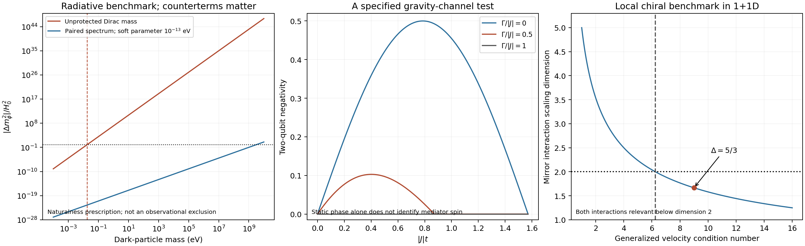

# Physical completion tests beyond finite W33 correspondences

This packet tests actual field-theory and experimental requirements: gravitational
vacua, quantum corrections, local chirality, charge quantization and operational
gravity measurements. It does not derive a common action explaining all of them.
The five models are explicitly separate where their assumptions differ.

The main findings are concrete. The preceding globally supersymmetric vacuum
becomes supersymmetric **AdS** in its declared supergravity completion. The recent
mass-varying dark-sector fits need an explicit protection mechanism if the varying
mass belongs to an ordinary heavy particle. An anomaly-free chiral benchmark can
be given positive local kinetics and relevant commuting interactions. Neutrino
operator requirements and the global gauge group remove anomaly solutions that
an anomaly-only argument would retain. A named classical gravity-channel model
has a quantitative entanglement/noise boundary, while static two-mass phases alone
cannot identify the mediator's spin.

These are useful constraints and constructions, not a solved TOE or claims of
new fundamental principles.
An additional sixth audit follows the sterile construction through coupled
Abelian gauge running and scalar thresholds; it does not treat anomaly freedom
as a UV-completion certificate.

## Intake, prior work and provenance

The non-W33 work from `22ae8fc22`, `68c0b3276`, `6e84d4b00`, `4b61d4c50`,
`e55ad2797`, `e7264c1ea` and the incoming `b5b4db003` was examined through its full research reports,
actual parameter certificates and relevant `analysis/toe_uv` producers. The
reserved `12550–12559` track (`af35e9345`) covers full CMB, field-space drag,
baryon couplings, rolling neutrinos and clocks. This packet does not duplicate
that likelihood work or alter those producers. The incoming dark-matter-drag
report was read in full before publication: its full-Planck control keeps
cprime near0.05, and post-hoc lensing raises one sample's indicated gain to
about3.1sigma. This updates the older background-only significance for that
sample; it is not represented here as a5sigma detection. The classical
matter-drag result also requires a stabilizing force or a reduced coupled
fraction when the full light-modulus gradient is large. The loop benchmark
below is a complementary particle-EFT test, not a rerun of CLASS or a
single-particle replacement for a regulated higher-dimensional KK tower.
Its numerical inputs remain the explicitly frozen earlier background-fit
certificates, not relabeled Planck posterior samples.

Relevant decisions are retained with their scope:

* Per **decision-b37f25d9-a5a6-4aa0-9a6c-ada375b17eda** [CLI, cite:9b7622],
  the fading-sector coupling is a conditional background fit, not a5-sigma
  detection; the low-redshift-cut suspicion was withdrawn after mock controls.
  The radiative calculation below therefore challenges a particle realization,
  not the existence of the data preference.
* Per **decision-1e442782-157b-4d3d-93ee-1541e755e922** [CLI, cite:8ab759],
  the true Higgs trajectory superseded an algebraic near-hit, and the prior
  smallest-generation result held only for its declared matter shape.
  Here neither a truncation-dependent coincidence nor an anomaly-only spectrum
  is promoted to a prediction.
* The earlier native29 stabilization and its exact holomorphic critical curve
  are reused as an actual candidate to couple to gravity. Their supplied mass
  matrix and scale remain inputs.

Local scientific diffs in the old TOE22/26/61 certificates were also inspected:
the displayed changes are numerical replay-level shifts, with their scale,
finite-volume and Gauss-law caveats intact. They are preserved, not silently
included in this packet. Earlier11969 supplies a different interacting Schwinger
continuum benchmark;11588 supplies an external/internal index distinction.
Neither is replaced by the new1+1D chiral benchmark.

Repository searches included the result index and a completed root-source/report
scan, plus targeted recent code and JSON reads. Broad recursive scans were slow,
and one60-second scan timed out; their null outputs are not exhaustive absence
proofs. The successful root scan covered over10000 source/report files and found
no applicable previous Haldane/3450, Kafri, or quintessence-radiative construction;
many bare-number hits were unrelated pass numbers or decimal substrings. No
priority claim follows. The larger full-week/PDF coverage audit remains incomplete.

## 1. A stable global SUSY vacuum does not solve the gravitational vacuum problem

Producer: `toe_20261103_supergravity_vacuum_completion.py`.
Input: the actual previous `w33_20261103_native_quantum_vacuum_displacement.json`.

Use its eight neutral fields `(t,z,r,q,l,k,S,T)` and supplied holomorphic
superpotential. Declare a canonical tree-level Kähler potential with weights
`(2,1,1,1,1,1,1,1)`: t occurs in two original canonical antisymmetric coordinates.
The Planck mass is another supplied scale. In ordinary two-derivative N=1 SUGRA,

`D_i W = partial_i W + w_i conjugate(phi_i) W/Mp^2`,
`V = exp(K/Mp^2)*(sum_i |D_i W|^2/w_i -3|W|^2/Mp^2)`.

The code solves the full16-real-coordinate covariant equations for all three
gaugino branches and Mp=10,30,100 in the common input mass unit. It does not
substitute global F-flatness for covariant F-flatness. Every numerical root has
small exported residuals and satisfies

`V=-3 exp(K/Mp^2)|W|^2/Mp^2 < 0`.

For the real branch the resulting energies are approximately
`-4.46557e-7`, `-4.78842e-8`, `-4.29219e-9` in the supplied mass unit to the
fourth power. **They are not numbers in eV4 and are not compared to the observed
dark-energy density without an additional scale dictionary.**

The neutral canonical scalar masses are also computed. At a supersymmetric AdS
point, in terms of the singular fermion masses mf and the gravitino mass mg,

`m_scalar^2 = mf^2 - 2mg^2 +- mg*mf`.

The lower branch is `(mf-mg/2)^2 -9mg^2/4`, satisfying the AdS stability bound.
All displayed neutral masses are positive. One case is independently checked by
finite differences in all16 real canonical coordinates, rather than relying
only on the supergravity formula. This is the neutral EFT spectrum; the
nonperturbative gauge-sector spectrum is not diagonalized.

Two attempted repairs are tested explicitly:

* Add a chosen constant `Wc=-W(global critical point)`. Then that point has
  both W=0 and its gradient zero, hence is exactly supersymmetric Minkowski.
  The same single constant does not cancel the other two branches. This is
  adjustable vacuum-energy tuning.
* Add a nilpotent field with `Kadd=X Xbar`, `Wadd=fX`, `X^2=0`. Choosing
  `|f|^2=3|W|^2/Mp^2` cancels the energy at the old AdS point, but gives
  `partial_i Vup=exp(K/Mp^2)*K_i*|f|^2/Mp^2` there. The exported gradients are
  nonzero. Energy cancellation alone has not constructed a stationary dS vacuum.

This is a consistency test of a declared low-energy SUGRA completion. Unknown
Kähler corrections, SUSY breaking, global branches and UV completion remain.
The formulas and the cosmological-constant difficulty are established physics;
see [Martin, section7.6](https://arxiv.org/html/hep-ph/9709356v7).

## 2. Radiative stability challenges a heavy-particle fading dark sector

Producer: `toe_20261103_dark_radiative_stability.py`.
Inputs: the six actual positive/negative branches stored for Pantheon+, Dovekie
and DES-SN5YR. The cosmological likelihood is not refitted.

Assume one4D Dirac particle, four degrees of freedom, with a physical mass
`m(phi)=m0 exp(-cp*x)`, `x=(phi-phi_today)/Mpl`. At subtraction scale mu=m0,
its MS-bar one-loop potential is

`DeltaV = [g*m0^4/(64*pi^2)] exp(-4cp*x)*(2cp*x+3/2)`.

Exact differentiation gives

`Delta m_phi^2 = g*cp^2*m0^4/(8*pi^2*Mpl^2)`.

Using the stored H0 and cp, a benchmark requiring this correction not to exceed
H0 squared gives the following particle-mass thresholds:

| stored fit | negative-c branch | positive-c branch |
|---|---:|---:|
|Pantheon+|0.01783 eV|0.01716 eV|
|Dovekie|0.01765 eV|0.01704 eV|
|DES-SN5YR|0.01722 eV|0.01657 eV|

**These are naturalness thresholds under the declared prescription, not
observational exclusions.** The background fit specifies a logarithmic mass
coupling, not an absolute dark-particle mass. Counterterms or a specified
protecting mechanism can change the conclusion. The generic radiative problem
is prior physics: [Garny](https://arxiv.org/abs/hep-ph/0606120),
[D'Amico–Hamill–Kaloper](https://arxiv.org/abs/1605.00996), and
[Hertzberg–Sandora–Trodden](https://arxiv.org/abs/1812.03184).

There are three additional controls, beyond evaluating the familiar estimate:

1. Subtract the loop value, slope and curvature at the present point using
   three local matching counterterms, then evaluate the remaining potential
   over the actual stored recombination-to-present excursion. In this specific
   prescription the cubic derivative vanishes and the residual starts with
   `-(16/3)*cp^4*x^4`; this accidental cancellation is not a symmetry. Exact
   high-precision residuals and their different mass thresholds are exported.
2. Equal boson/fermion spectra with identical couplings cancel their CW
   functions. With a small constant soft offset
   `mB^2=mF^2+Delta^2`, the leading correction instead scales as
   `g*cp^2*m0^2*Delta^2/(8*pi^2*Mpl^2)`. The allowed Delta is exported, with
   the physical partner splitting `Delta^2/(2*m0)` distinguished from Delta.
3. A unitary mass orbit `M(phi)=U(phi) M0 V(phi)^dagger` keeps every singular
   mass and `Tr f(Mdagger M)` constant. It protects this mass-determinant loop,
   but has **physical cp=0**. Changing only a mass phase does not implement the
   fitted fading of its magnitude. The explicit diagonal phase example is checked.

The connection to section1 is quantitative rather than a proposed unification.
If an additional mediation model gives `Delta approximately m_gravitino`, then

`mDM*m_gravitino <= sqrt(8*pi^2/g)*H0*Mpl/cp`

is the displayed no-cancellation benchmark. Exact-SUSY protection has to survive
the SUSY breaking needed for a positive vacuum in ordinary SUGRA. A sequestering
claim now has a numerical target. No common UV model or mediation law is assumed
to have been derived.

## 3. A local chiral benchmark with relevant, mutually commuting interactions

Producer: `toe_20261103_chiral_mirror_benchmark.py`.

This uses published1+1D3450 matter, with

`K=diag(1,1,-1,-1)`, `q=(3,4,5,0)`,
`l1=(1,-2,-1,2)`, `l2=(2,1,2,1)`.

The gauge anomaly `q^T K q` and gravitational anomaly TrK vanish. The two cosine
arguments obey `L K L^T=0` and `L K q=0`: the interactions commute in the null
pairing and preserve the gauge symmetry. Their six integer2-by2 minors are
`(5,4,-3,-3,-4,-5)`, with gcd1. This verifies primitivity, rather than treating
an arbitrary multiple of a null vector as an equivalent gapping interaction.

At the free point both interactions have scaling dimension5, so anomaly
cancellation alone has not made them relevant. Define

`P=L^T L/10`, `V=3P+(I-P)/3`.

V is positive, with eigenvalues1/3,1/3,3,3. It obeys `V K V=K`, so all four
characteristic velocities are+-1. Both interaction dimensions are now5/3,
below2. In a declared harmonic strong-pinning approximation the four branches
obey `omega^2=k^2+10*mu^2/3`. The parameter mu is supplied; this is not an exact
sine-Gordon mass from a microscopic bare coupling.

Within this unit-speed Gaussian class, making either norm-sqrt10 row relevant
requires a generalized velocity condition number greater than25/4 relative to
the specified free-fermion metric. The displayed matrix has condition9. This
is not an unqualified Euclidean norm statement: a nonorthogonal unimodular
basis change is replayed with K, q, L and the reference metric all carried.
Charges, nullity, dimensions and generalized eigenvalues agree exactly.

The mechanism belongs to [Wang–Wen](https://arxiv.org/abs/1307.7480).
The2026 [Thorngren–Preskill–Fidkowski work](https://arxiv.org/abs/2601.04304)
provides a separate symmetry-disentangler route, including an exactly solvable
3450 rotor construction and a proposed3+1D extension. It is not our invention.
Here the useful deliverable is a fully specified stable continuum benchmark,
with relevance and basis controls. A4D non-Abelian chiral SM regulator, finite
rotor truncation and emergent spacetime remain unbuilt by this packet.

## 4. Anomaly cancellation, global gauge group and mass operators are different tests

Producer: `toe_20261103_sterile_anomaly_operators.py`.

Take the observed three SM generations as input and add three left-handed
singlet Weyl fields charged under a supplied gauged B-L. All mixed SM/B-L
anomalies vanish independently; the SM-only gravitational and cubic B-L
anomalies are both-1 per generation.

An important normalization check changes an overly narrow answer. If the
singlet charges are restricted to integers in ordinary B-L units, the familiar
solutions are `(1,1,1)` and permutations of `(-5,4,4)`. Their right-handed
conjugates are the standard and known exotic assignments; see
[Machado–Pleitez](https://arxiv.org/abs/1105.6064) and
[earlier work](https://arxiv.org/abs/1008.4572).

But quarks have B-L=1/3. For the direct-product gauge group use integer
`Q=3(B-L)` and permit **all integer singlet Q charges**. The conditions are

`sum Q_i=9`, `sum Q_i^3=81`.

There are exactly three unordered solutions in this charge lattice:

`(3,3,3)`, `(-15,12,12)`, `(-18,10,17)`.

This is a cutoff-free classification, not just a charge scan. Subtract the
mean3 and write `(a,b,-a-b)`, with `a=g*u,b=g*v`, gcd(u,v)=1. Apart from the
all3 solution, the cubic equation gives

`6*(u^2+u*v+v^2)=g*u*v*(u+v)`.

The quadratic factor is coprime to u,v,u+v separately. Thus u, v and u+v each
divide6, reducing the entire integer problem to a finite divisor enumeration.
The ordinary-integer-B-L proof instead uses divisors of2. An independent server
enumeration through charge200 corroborates the result; it is not the global proof.
One or two singlets cannot solve the stated conditions.

Now add a scalar Phi of Q=9, leaving Z9 for the declared direct product before
optional color-center quotients. An `L H n` mass operator can be completed with
Phi/Phi-dagger powers iff `Q_n=3 mod9`. Requiring all three Dirac columns
therefore retains the standard/exotic sectors and excludes `(-18,10,17)`.
The latter was anomaly-free; it fails this **additional operator hypothesis**.

For the exotic sector the two Q=12 columns arise at dimension5 and the Q=-15
column at dimension6. An explicit coefficient matrix gives determinant
`epsilon^4`, so generic Dirac masses are full rank. With O(1) coefficients,
two masses scale as `epsilon*vH` and one as `epsilon^2*vH`. Using0.05eV only
as an illustrative heavy mass gives a light parametric scale about1.44e-14eV.
The Wilson coefficients, epsilon and ordering are not predicted.

The Weinberg operator has residue-6 mod9; every sterile Majorana bilinear in
these two sectors has nonzero residue as well. Arbitrary insertions of the
single Phi cannot generate them. This is an explicit residual-gauge-symmetry
Dirac protection mechanism, not an appeal to an unprotected global lepton number.

There is a separate global-group filter: for `(SU3_color x U1_BL)/Z3`,
representations obey `Q mod3=color triality`. Color singlets then need Q
divisible3, excluding `(-18,10,17)` already. The quotient and direct product
are distinct choices, not interchangeable notation. The code makes both
assumptions explicit. None of this selects three generations or the gauge group;
it prevents an anomaly-only argument from claiming too much.

### Additional UV check: charge choice, kinetic mixing and scalar thresholds

Producer: `toe_20261103_abelian_uv_matching.py`. This consumes the freshly
regenerated sterile certificate after that producer finishes.

Use gauge fields with charges in the covariant derivative and couplings in the
inverse kinetic matrix K. The coupled one-loop equation is

`K(mu)=K(mu0)-B*log(mu/mu0)/(8*pi^2)`,
`B_ab=(2/3)*Tr_Weyl(q_a q_b)+(1/3)*Tr_complex_scalar(q_a q_b)`.

The offdiagonal is retained. For the actual three-generation SM, one Higgs
doublet, the three indicated singlets and Phi(B-L=3),

`B_YY=41/6`, `B_Y,BL=16/3`,
`B_BL,BL=41/3` for the standard singlets and `149/3` for the exotic singlets.

The usual standard model with Phi(B-L=2) instead gives bBL=12, an independent
normalization control. The framework is established; see
[Basso–Moretti–Pruna](https://arxiv.org/abs/1004.3039).

As an illustration, choose a3TeV matching scale and gY=0.36, and estimate the
dimension5 operator cutoff from `epsilon=0.05eV/(174GeV)`, obtaining about
1.04e16GeV. Requiring K to remain positive through that cutoff gives
gBL below about0.418 for the standard sector and0.230 for the exotic sector.
The third charge sector gives about0.203, independently of its earlier mass
operator failure. These are conditional one-loop no-pole bounds, weaker than
full perturbativity or vacuum-stability conditions. Couplings, thresholds and
the illustrated neutrino mass remain inputs. A different intermediate gauge
structure or spectrum changes the running.

The first pole is checked both by an eigenvalue construction and detK=0. An
explicit nonorthogonal gauge-field basis change preserves the pole when the
charge lattice and the entire kinetic matrix are carried. Independent diagonal
running would omit a physical effect.

There is also a sharp threshold control. The familiar generator
`X=5(B-L)-4Y` is orthogonal to Y on the fermion trace, but the lone light
Higgs doublet contributes `Tr_scalar(YX)=-2`, leaving a mixed one-loop
coefficient-2/3. A colored triplet with Y=-1/3, B-L=-2/3 and X=-2 restores
the scalar trace cancellation when it is active with the doublet. Thus even
complete standard fermion multiplets do not justify zero mixing below scalar
thresholds. This is a threshold explanation, not a constructed unification
model or a proton-decay analysis. X is a charge diagnostic here, with no silent
primitive relabeling of the global group.

## 5. Gravity-entanglement experiments need a named alternative model

Producer: `toe_20261103_gravity_entanglement_models.py`.

Consider a specified two-qubit generator, starting from |++>:

`rho_dot=-i[J Z1 Z2,rho]+Gamma*(Z1 rho Z1-rho)+Gamma*(Z2 rho Z2-rho)`.

For `p=exp(-2 Gamma t)`, the partial-transpose eigenvalues are

`(1+p^2 +-2p cos(2Jt))/4`, `(1-p^2 +-2p sin(2Jt))/4`.

Thus the exact negativity is

`max(0,p/2*(|sin(2Jt)|-sinh(2 Gamma t)))`.

For Gamma>=|J| this input never entangles; for Gamma<|J| it entangles at
sufficiently short positive times. Direct matrix-exponential Lindblad evolution
independently checks the formula. An explicit finite-step local weak measurement
plus classical feedback protocol converges to the Gamma=|J| generator. Every
step is LOCC, and every tested step count remains separable on the product input.
This instantiates the prior [Kafri–Taylor–Milburn idea](https://arxiv.org/abs/1401.0946).

For a supplied geometry with two1e-14kg masses, transverse separation200microns
and arm250microns, the Newtonian entangling rate has magnitude0.05938/s and the
ideal first maximal-entanglement time is13.23s. These are benchmark inputs,
not an apparatus design, noise budget or observation.

An identifiability control is essential. The entangling invariant is
`J=(V00-V01-V10+V11)/(4 hbar)`. A massless quantum scalar with matched static
1/r strength gives the same two-mass phase Hamiltonian and density matrices.
That experiment alone cannot identify spin2. A minimal trace-coupled scalar has
no tree-level coupling to classical Maxwell radiation, so matter-photon probes
can distinguish that specified alternative; more general photon couplings or
trace anomalies require separate analysis. The2026
[matter-photon proposal](https://arxiv.org/abs/2604.24496) motivates that direction.

The current debate matters: [Di Biagio, October2026](https://doi.org/10.1103/r8ry-sp35)
distinguishes information-theoretic locality from spacetime locality, while
[Marletto et al.](https://arxiv.org/abs/2511.07348) challenge a claimed classical
counterexample. Our conclusion is deliberately model-specific: violating the
displayed boundary rejects this Markovian measurement-feedback alternative.
It is not a theorem excluding every hybrid, nonlocal or matter-mediated theory,
and it does not establish a full quantum theory of Einstein gravity.

## Verification, figure and remaining objective

Run `py -3 analysis/toe_20261103_physical_completion_validation.py`. It regenerates
the five main producers in three local workers, then the dependent sixth UV
audit, preserves the four actual baseline input JSON
hashes, and runs isolated pytest with legacy repository conftest disabled. The
final replay reports **36 tests passed**; actual commands, outputs and earlier
implementation repairs are retained. No all-repository test claim is made.

Local work used Remote Desktop Commander while an independent V8 server program
checked the integer charge enumeration, primitive minors, mirror characteristic
identity, CW mass scale and24 partial-transpose trace moments. Its standalone
JavaScript source and receipt are committed. These local execution surfaces share
one physical Windows machine; they are not falsely counted as multiple computers.

The standalone Matplotlib figure was rendered and visually inspected:

An SVG export is included for sharing. The figure labels the naturalness and
model assumptions explicitly.

The new connection is between requirements that must coexist in a real theory:
gravitational vacuum completion, radiative protection, local chiral dynamics,
anomaly/global-group consistency and discriminating observables. Meeting each
in separate supplied models is not enough. A common UV action with the measured
parameters, observed positive vacuum energy and controlled4D continuum limit is
still the central missing object.

Five independent next investigations:

1. Construct and match a radiatively protected mass-varying dark sector, including the SUSY-breaking/sequestering terms rather than assuming them.
2. Build a complete stationary positive-energy gravitational vacuum and test its full scalar Hessian and radiative stability.
3. Implement a genuinely4D chiral regulator with explicit gauge operators and controlled mirror removal.
4. Derive the B-L global group and scalar-breaking sector in a UV model, then test the resulting neutrino hierarchy and flavor observables.
5. Calculate joint mass-mass and matter-photon predictions for competing gravity models with a realistic environmental noise model.
