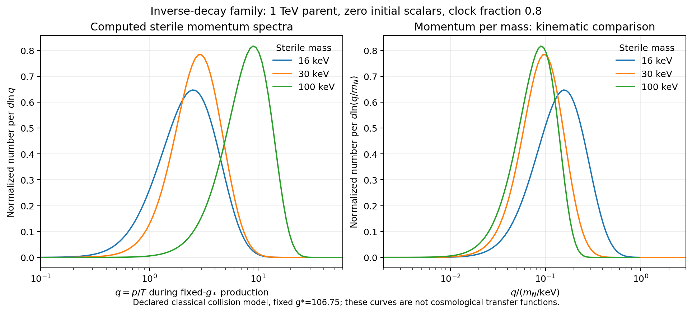

# Inverse Higgs production removes the annihilation-only floor

The current sterile-neutrino proposal omitted an allowed population mechanism when identifying its portal window. In a specified classical collision model, bath Higgs-pair inverse decays populate the scalar even below the earlier annihilation-only portal floor. The calculation gives a wider conditional production family, including a1TeV parent, without assuming the parent remains thermal. It supplies actual nonthermal momentum spectra and an integrated abundance identity. It does not establish a complete hot Standard Model calculation or protect the dark-energy potential.

## Inputs and prior ownership

The starting points are the actual certificates used by `toe_uv/sterile_lya.py` and `sterile_hh.py`, and the canonical normalization audited in commit3869fe29c. The older window required approximately `lambda_p >= sqrt(32 pi mS/M0)` to keep the scalar thermal by annihilations. The latest report narrowed its proposed corridor to M_N around16keV and mS around3TeV, while explicitly leaving the Boltzmann calculation open.

Scalar-decay freeze-in, inverse processes and nonthermal momentum calculations are established physics. [Merle and Totzauer1502.01011](https://arxiv.org/abs/1502.01011) provide the kinetic framework and examples of distinct production regimes; [Koenig, Merle and Totzauer1609.01289](https://arxiv.org/abs/1609.01289) explain why structure formation needs full distributions. [Hall et al.0911.1120](https://arxiv.org/abs/0911.1120) give the standard equilibrium-decay yield. Those mechanisms are not new discoveries here. This packet tests the current repo's particular portal-window inference and freezes an explicit normalized collision calculation.

The closest production precedent is [De Romeri, Karamitros, Lebedev and Toma2003.12606](https://arxiv.org/abs/2003.12606), especially sections4.2-4.2.1 and6.2.1-6.2.3. They explicitly include Higgs fusion, thermalization restrictions and the scalar-yield times sterile-branching relation. Their treatment also addresses thermal masses and changing Higgs degrees of freedom, absent here. Thus the fusion mechanism and branching argument are prior literature; this packet corrects the repo's particular floor inference and calculates its declared classical momentum benchmark. Selected relevant HTML sections were read, not the entire paper.

The repo was fetched and searched before construction. Targeted sterile/Boltzmann searches found the current reports and missing-calculation discussion; broad `dYS` searches also matched unrelated Dyson identifiers, which are not kinetic certificates. An additional exact citation search for2003.12606 found no matches in RESULTS_INDEX.md, analysis, data, papers or docs with the declared2MB per-file cap. The search record states its scope and does not turn a null result into priority evidence. No new numbered pass was claimed.

## A declared collision action and its limits

Use canonical real scalar fluctuation s about w, with mass mS supplied, four effectively massless bath real scalars h_a in Maxwell-Boltzmann equilibrium, and

    Vportal = lambda_p/4 (w+s)^2 sum_a h_a^2
    mN = y w,  w = vS/sqrt2.

The zero-temperature self-potential selecting w and mS is not specified by this transport calculation. Scalar self-collisions are taken negligible. In particular, imposing the minimal broken-Z2 quartic afterward introduces additional interactions whose effect has not been computed.

The included processes are `ss <-> h_a h_a`, elastic `s h_a <-> s h_a`, `s <-> h_a h_a`, and `s -> NN`. The bath is a fixed reservoir; sterile backreaction is omitted. The rates in this convention are

    Gamma_NN = y^2 mS/(16 pi)
    Gamma_hh = lambda_p^2 w^2/(8 pi mS).

The latter sums four identical-final-state channels. It is half the earlier `sterile_hh.py` expression when that expression retains vS in place of canonical w. All comparisons here use the normalized convention.

Set r=mS/T, q=p/T, E=sqrt(q^2+r^2), g*=g*s=106.75 and M0=MPl/(1.66sqrt(g*)). Define

    A = lambda_p^2 M0/(32 pi^3 mS)
    DN = M0 Gamma_NN/mS^2,  DH = M0 Gamma_hh/mS^2
    J = integral dq q^2 fS(q,r)/E,  Jeq = r K1(r).

The tagged-s contact collision includes the identical-final-state phase factor1/2. Equivalently, summed `sigma vM = 4lambda_p^2/(64pi E1 E2)`. An independent invariant thermal-cross-section integral checks this normalization.

The scalar equation is

    dfS/dr = { A[Jeq exp(-E)-J fS]
               + r^2[DH(exp(-E)-fS)-DN fS] }/E + Lelastic fS.

No scalar kinetic-equilibrium closure is imposed. The explicit elastic kernel has positive transitions, conserves scalar number exactly in the chosen quadrature and obeys MB detailed balance. Its equilibrium-weighted similarity transform is symmetric with nonpositive eigenvalues. Its absolute normalization also reproduces the heavy-parent-at-rest limit `Gamma_el/H = 8A/r`, independently obtained from bath number density times the elastic cross section.

Each decaying parent at(q,r) contributes two massless daughters uniformly distributed over `[(E-q)/2,(E+q)/2]`. Exact overlaps with daughter momentum bins preserve number; analytic angular integrals independently give their first three moments. The stored distributions are spin summed and normalized through `Y_N=45/(4pi^4 g*s) integral dq q^2 fN`.

## An integrated identity explains the otherwise surprising yield

Let `IS=integral dq q^2 fS`, `IN=integral dq q^2 fN`, `c=45/(4pi^4 g*s)` and `BRN=DN/(DN+DH)`. Integrating the scalar equation gives

    IN = 2 BRN [ IS(initial)-IS(final)
                 + A integral dr (Jeq^2-J^2)
                 + DH integral dr r^3 K1(r) ].

Elastic scattering drops out by number conservation. Independent quadratures verify

    integral_0^infinity dr r^3 K1(r) = 3pi/2
    integral_0^infinity dr [r K1(r)]^2 = 3pi^2/32.

Dropping the negative contact-loss term gives a source upper bound, checked against every computed case. With A=0, zero initial scalars and complete final decay, the identity becomes

    YN = 2c (3pi/2) DN DH/(DN+DH).

This equality does not require `fS=exp(-E)`. If DH greatly exceeds DN, the Higgs inverse-production rate and the small sterile branching fraction cancel, giving nearly the familiar equilibrium-parent abundance even when the parent distribution is not thermal. This is standard integrated source/branching logic applied to the actual proposal, not a new general freeze-in theorem.

It follows that the annihilation-only floor is not a necessary condition for producing the stated abundance. A satisfactory abundance alone also does not validate the assumed equilibrium decay spectrum.

## The older sampled points depend on initial conditions

At the geometric mean of the old portal floor and ceiling, using normalized widths:

| M_N | mS | Omega h^2, zero initial S | Omega h^2, inherited thermal-MB S |
|---|---|---|---|
|16keV|3TeV|0.12994|0.33743|
|16keV|10TeV|0.44393|3.44486|
|18keV|10TeV|0.35033|3.62654|
|20keV|10TeV|0.28805|3.76589|

The full packet evaluates all three portal positions and both initial conditions at the four stored points:24 cases. Neither initial condition is selected by a reheating model. These are numerical results of the declared approximation, not measured abundances or universal overproduction bounds.

## A constructive family outside the old portal floor

Retain the inherited clock proxy with b=.053, alpha_max=2.2e-6 and mh=125.25GeV. Choose a margin eta=.8 of its portal ceiling:

    lambda_p = eta alpha_max mh^2/(2 b w^2).

Then

    Gamma_hh/Gamma_NN
      = [eta alpha_max mh^2/(sqrt2 b mN mS)]^2,

independent of y. Choose y so the analytic no-contact, zero-initial identity gives the **input target** Omega h^2=.12. The full momentum solver then retains contact gain/loss and elastic scattering. For a supplied1TeV parent:

| Supplied M_N | w (GeV) | lambda_p | lambda_S if minimal Z2 imposed | Full Omega h^2 | mean q |
|---|---|---|---|---|---|
|16keV|1161.45|1.931e-7|0.37066|0.120389|2.6113|
|30keV|2974.92|2.943e-8|0.05650|0.120066|3.0464|
|100keV|17530.24|8.476e-10|0.001627|0.120002|8.4615|

All portals lie below the old1TeV annihilation-only floor, approximately3.759e-7. The displayed Z2 quartics are **diagnostics**, not self-interactions included in the transport equations. A quartic below one does not imply self-number-changing collisions are negligible. This table does not certify that minimal potential.

The density is an input used to construct y; these are not dark-matter mass predictions or new likelihood fits. The small offsets above.12 come from the retained contact contribution. The examples show why a16-20keV upper corridor does not follow generally from the earlier annihilation-floor argument. They do not establish that these masses pass all astrophysical or UV constraints.

The100keV example has a higher mean q but a smaller q/mN than the16keV example. This is a kinematic comparison of the actual computed distributions, not a replacement for a self-gravitating transfer function.

## Numerical evidence and the physical boundary

The PC producer solves the parent distribution with BDF and an analytic nonlinear Jacobian. An actual server-V8 program independently constructs Newton-Legendre quadrature and uses a positive exponential-midpoint integrator. It checks four old histories, the three new examples and an additional refinement. No PC Python calculation is substituted for server execution. Remote Desktop Commander was checked offline; available local execution continued alongside the server calculations.

The final harness regenerates27 full and11 quick cases, runs13 focused tests, refines five spectra from96 to144 parent nodes and1001 to1801 time samples, and extends a momentum cutoff from50 to70. In the recorded refinements, relative abundance/moment changes are below1.3e-7 and normalized histogram-CDF changes below1.3e-5. The image was visually inspected. The receipt records actual execution results and source/input/output hashes; passing numerical checks certify only this collision model.

The thermal limitations are material. For the16,30,100keV examples, approximately8.7%,20.0%,93.2% of sterile production occurs below160GeV. About7.9% of the modeled inverse-Higgs source lies below that temperature in all three1TeV examples. Fixed g*, a massless four-component bath and constant vevs need replacement across the electroweak and scalar transitions. Finite-bin sterile occupancy is small in the output, but this is not a pointwise Pauli proof or a computed NN inverse-decay correction.

Quantum statistics, scalar self-collisions, thermal masses, entropy evolution, the early reheating history and the later coupled-cosmology transfer function remain uncomputed. The previous quantum-loop instability of the dark-energy potential also remains: a perturbative scalar quartic and a matching relic density supply no protecting symmetry. A common scalar/SM/quintessence potential must be built and audited before claiming a physical completion.

This is concrete progress from order-one population estimates to a normalized momentum calculation and an explicit wider production family. It does not solve the TOE or complete the outstanding weekly/PDF reading. Cumulative manuscript full-text coverage remains1-72 of215 pages.
